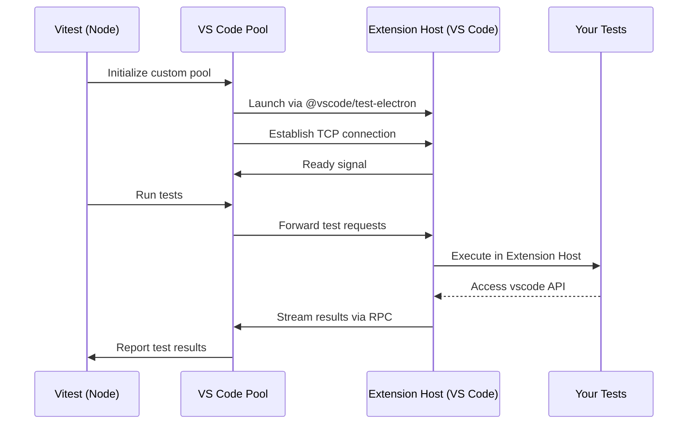

# vitest-vscode-runner

[](https://github.com/Darhagonable/vitest-vscode-runner/actions/workflows/ci.yml)
[](https://opensource.org/licenses/MIT)

**Test your VS Code extensions with the real deal.** A Vitest plugin that runs your test suites inside an actual VS Code Extension Host—no mocks, no compromises.

> This project is derived from [vitest-environment-vscode](https://www.npmjs.com/package/vitest-environment-vscode) ([repo](https://github.com/andrew-w-ross/vitest-enviroment-vscode)) by [andrew-w-ross](https://github.com/andrew-w-ross) and [@gitbybit/vscode-extension-test-vitest-runner](https://www.npmjs.com/package/@gitbybit/vscode-extension-test-vitest-runner) by [neochief](https://github.com/neochief).

## Why This Exists

Testing VS Code extensions shouldn't require elaborate mocking strategies or heavyweight fixtures. This plugin lets you:

- ✅ **Test against the real `vscode` API** — no synthetic stubs
- ✅ **Write standard Vitest tests** — same expect, describe, it you already know
- ✅ **Get fast feedback** — reuse the Extension Host across files for quick iteration
- ✅ **Debug naturally** — set breakpoints and inspect state like any Node.js app

## Quick Start

### 1. Install

```bash
npm install --save-dev vitest vitest-vscode-runner
# or
yarn add -D vitest vitest-vscode-runner
# or
pnpm add -D vitest vitest-vscode-runner
```

### 2. Configure

```ts
// vitest.config.ts
import { defineConfig } from 'vitest/config';
import { vscodeRunner } from 'vitest-vscode-runner';

export default defineConfig({
  plugins: [
    vscodeRunner({
      version: 'insiders', // or 'stable' / specific VS Code version tag
      reuseWorker: true,
    }),
  ],
  test: {
    include: ['src/**/*.test.ts'],
  },
});
```

#### Configuration Options

`vscodeRunner` accepts these options:

| Option                     | Default      | Description                                                                                                                                                                                                 |
| -------------------------- | ------------ | ----------------------------------------------------------------------------------------------------------------------------------------------------------------------------------------------------------- |
| `version`                  | `'stable'`   | VS Code build to download: `'stable'`, `'insiders'`, or a specific version tag like `'1.143.1'`. Overridden by `VSCODE_VERSION` environment variable if set.                                                |
| `reuseWorker`              | `true`       | Allow Vitest to reuse the extension-host worker across test files.                                                                                                                                          |
| `vscodeExecutablePath`     | `undefined`  | Path to a VS Code executable to use for testing. If not specified, VS Code will be downloaded based on `version`.                                                                                           |
| `reuseMachineInstall`      | `false`      | Whether VS Code should be launched using default settings and extensions installed on this machine. If `false`, then separate directories will be used inside the `.vscode-test` folder within the project. |
| `extensionDevelopmentPath` | project root | The extension root loaded into the development host.                                                                                                                                                        |
| `launchArgs`               | `[]`         | Additional arguments passed to the VS Code executable. See [`code --help`](https://code.visualstudio.com/docs/configure/command-line) for available options.                                                |
| `platform`                 | (auto)       | VS Code platform to download: `'darwin'`, `'darwin-arm64'`, `'win32-x64-archive'`, `'win32-arm64-archive'`, `'linux-x64'`, `'linux-arm64'`, `'linux-armhf'`                                                 |
| `cachePath`                | (auto)       | Directory where downloaded VS Code instances are cached. Defaults to `.vscode-test` in your project.                                                                                                        |
| `timeout`                  | `undefined`  | Milliseconds to wait for VS Code download before timing out.                                                                                                                                                |

**Common Use Cases:**

- **Pin a specific VS Code version:** Set `version: '1.143.1'` for reproducible CI builds
- **Test multiple VS Code versions in CI:** Use a GitHub Actions matrix with the `VSCODE_VERSION` environment variable:
    ```yaml
    jobs:
        test:
            strategy:
                matrix:
                    vscode-version: [stable, insiders]
            steps:
                # ... setup steps ...
                - name: Run tests
                  run: npm test
                  env:
                      VSCODE_VERSION: ${{ matrix.vscode-version }}
    ```
    See the [full CI workflow example](.github/workflows/ci.yml) for a complete setup.
- **Use your local VS Code:** Set `vscodeExecutablePath: '/Applications/Visual Studio Code.app/Contents/MacOS/Electron'` to test against your installed copy
- **Test with specific settings:** Use `reuseMachineInstall: true` to test with your actual VS Code configuration
- **Add workspace folders:** Include `launchArgs: ['path/to/workspace']` to open a specific workspace when testing

### 3. Write Tests

The real `vscode` API is available in your tests—write standard Vitest suites:

```ts
// src/extension.test.ts
import { describe, it, expect } from 'vitest';
import * as vscode from 'vscode';

describe('hello command', () => {
	it('executes inside VS Code', async () => {
		const result = await vscode.commands.executeCommand('my-extension.hello');
		expect(result).toBeUndefined();
	});
});
```

### 4. Run Your Tests

```bash
yarn vitest
# or
npm test
```

**Pro Tips:**

- Set `VSCODE_VERSION=insiders` (or `stable`, or a specific version) to override the configured version—useful for testing against multiple VS Code builds in CI
- Point Vitest's `root` at your extension directory, or pass `extensionDevelopmentPath`

## Debugging in VS Code

If you're using VS Code (you probably are), drop the snippet below into your extension repo's `.vscode/launch.json`:

```jsonc
{
	"version": "0.2.0",
	"configurations": [
		{
			"type": "node",
			"request": "launch",
			"name": "Vitest: Debug Extension Tests",
			"autoAttachChildProcesses": true,
			"cwd": "${workspaceFolder}",
			"skipFiles": ["<node_internals>/**"],
			"program": "${workspaceFolder}/node_modules/vitest/vitest.mjs",
			"args": ["run", "--inspect-brk", "--no-file-parallelism"],
			"smartStep": true,
			"console": "integratedTerminal",
		},
		{
			"type": "node",
			"request": "attach",
			"name": "Attach to vscode-worker",
			"continueOnAttach": true,
			"port": 9229,
		},
	],
	"compounds": [
		{
			"name": "Vitest: Debug Extension Host",
			"configurations": ["Vitest: Debug Extension Tests", "Attach to vscode-worker"],
			"stopAll": true,
		},
	],
}
```

Then:

1. Open the **Run and Debug** view (`Ctrl+Shift+D` / `Cmd+Shift+D`).
2. Pick **Vitest: Debug Extension Host**.
3. Press **F5** and wait for VS Code to attach.

Behind the scenes, the first config launches Vitest with `--inspect-brk`, and the second attaches to the Extension Host worker once it starts.

Set breakpoints anywhere in your Vitest specs or extension code; once the corresponding worker spins up, they'll hit. Use the Debug Console to evaluate values or run `vscode` commands on the fly.

## How It Works



1. Vitest (running in Node) initializes the custom pool
2. The pool launches VS Code and the bridge inside the Extension Host connects back over TCP
3. Your tests execute inside the Extension Host with full access to the real `vscode` API
4. Test results stream back through the pool to Vitest's reporters

## Repository Layout

| Path                          | Description                                        |
| ----------------------------- | -------------------------------------------------- |
| **`src/`**                    | The plugin, custom pool, and extension-host bridge |
| **`tests/sample-extension/`** | Sample VS Code extension used as a test fixture    |

### Development

```bash
# Install dependencies
pnpm install

# Build
pnpm build

# Run all tests
pnpm test

# Run the sample extension directly
pnpm test:sample-extension

# Typecheck
pnpm typecheck
```

## Contributing

Contributions welcome! Please open an issue first to discuss what you'd like to change.

## License

MIT
